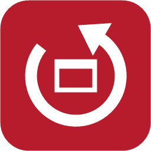
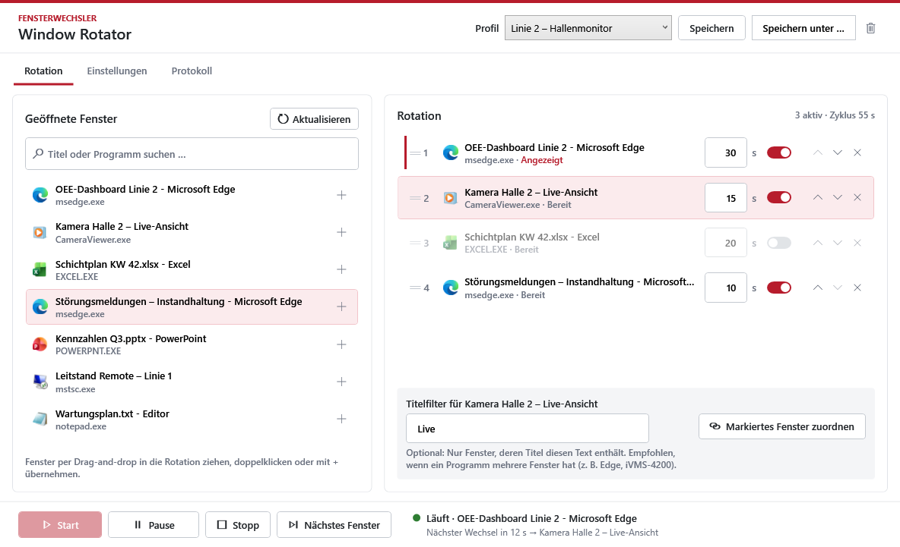
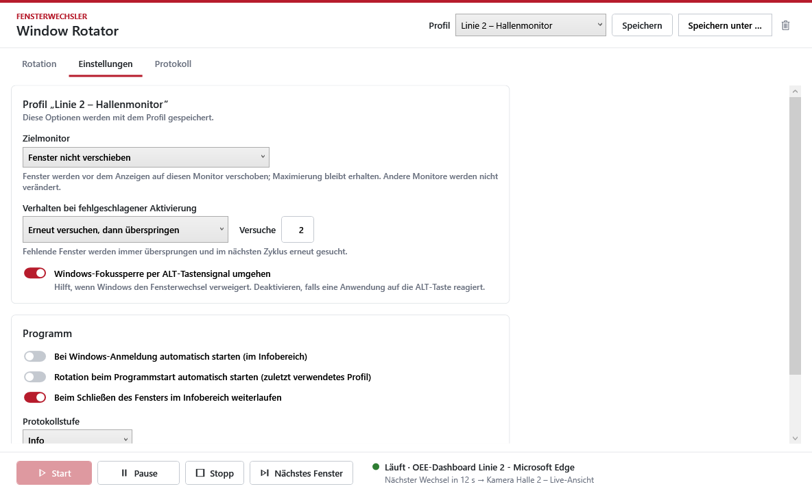
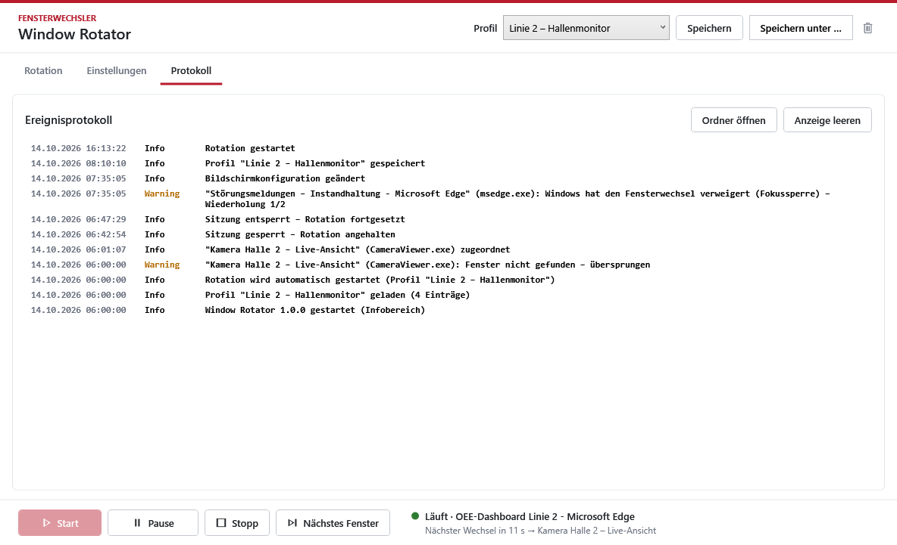
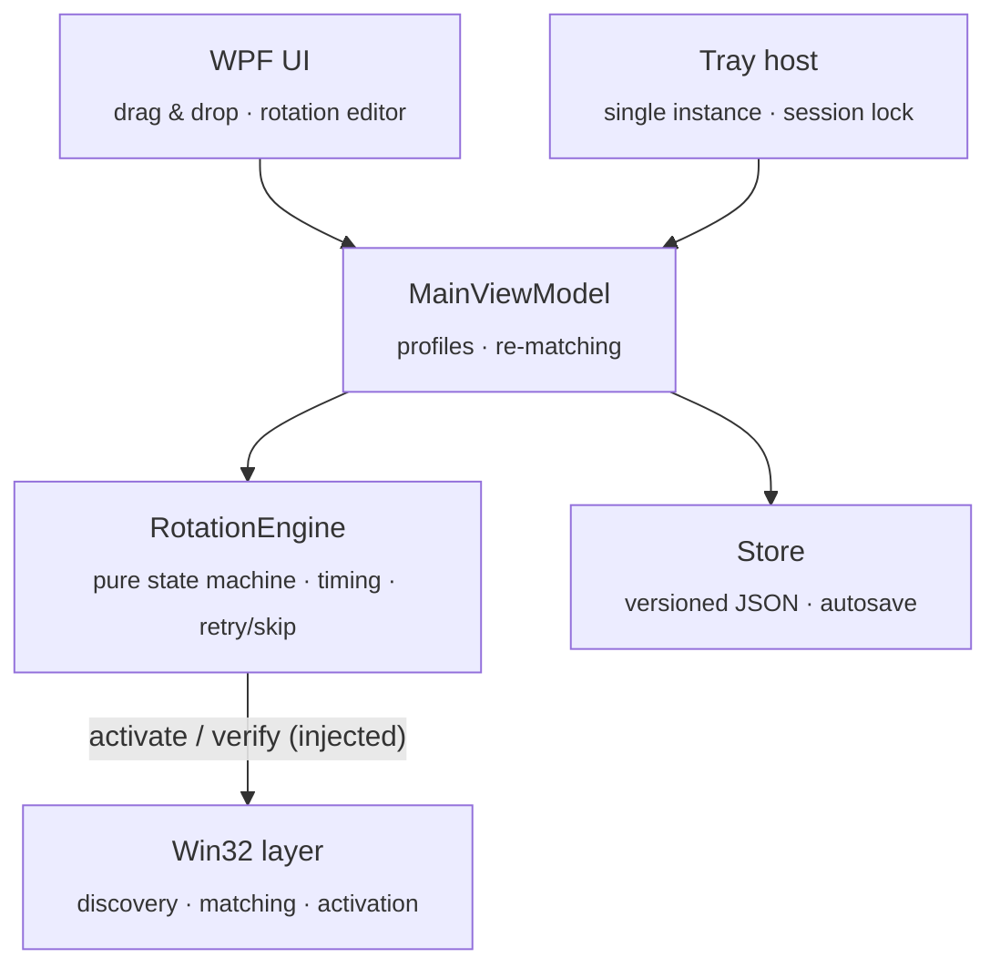

<div align="center">



# Window Rotator

**Your wall display, on autopilot.** 🔄

Rotate any running Windows apps – dashboards, camera feeds, spreadsheets – on a shop-floor or office display.
Drag, drop, set the seconds, hit Start, close the window. It just keeps going.

[](https://github.com/samyness/window-rotator/actions/workflows/ci.yml)
[](https://github.com/samyness/window-rotator/releases/latest)
[](LICENSE)


[**⬇ Download**](https://github.com/samyness/window-rotator/releases/latest) · [Quick start](#-quick-start) · [How it works](#-how-it-works) · [Docs (DE)](docs/Administratorhandbuch.md) · [Roadmap](#-roadmap)



</div>

---

## 🤔 Why?

Every factory hall, control room and open office has *that* screen: one PC, one big monitor, and three things people need to see – the production dashboard, the camera feed, the shift plan. Someone switches between them by hand. Or nobody does.

Browser tab rotators only rotate browser tabs. Kiosk software wants you to rebuild everything as a web page. **Window Rotator rotates the real windows you already have open** – any app, as-is.

## ✨ Features

| | |
|---|---|
| 🖱️ **Drag & drop setup** | All open windows with icon and title on the left – drag them into your rotation. No config files, no scripting. |
| ⏱️ **Per-window timing** | 30 s for the dashboard, 15 s for the camera. Live total cycle time. Toggle entries on/off without deleting them. |
| 🧠 **Survives restarts** | App crashed? PC rebooted? Windows are re-matched by process, class and title – and it **never guesses**: a wrong window on a wall display is worse than none. |
| 🖥️ **Multi-monitor aware** | Pick a target display; windows are moved there (maximized state kept), other screens stay untouched. |
| 🫥 **Lives in the tray** | Close the window, rotation keeps running. Pause, resume, next, stop – all from the tray menu. |
| 🛡️ **Built for 24/7** | Monotonic clock, hung-app detection, verified activation with retry-then-skip, auto-pause on session lock, crash-safe atomic saves, daily logs. |
| 🚀 **Autostart** | Starts at logon straight into the tray and resumes your last profile. |
| 🪶 **Zero dependencies** | Native WPF on .NET 10, single self-contained EXE. No Electron, no browser, no runtime install. |

<table>
<tr>
<td></td>
<td></td>
</tr>
<tr>
<td align="center"><sub>Per-profile options & program settings</sub></td>
<td align="center"><sub>Event log for unattended operation</sub></td>
</tr>
</table>

> The UI is in German for now – English localisation is on the [roadmap](#-roadmap). PRs welcome! 🇬🇧

## 🚀 Quick start

1. Grab `WindowRotator-<version>-win-x64.zip` from the [latest release](https://github.com/samyness/window-rotator/releases/latest) and unzip it (downloaded? `Unblock-File` first – the EXE isn't signed yet).
2. Install for the current user – no admin rights needed:
   ```powershell
   powershell -ExecutionPolicy Bypass -File Install.ps1 -Autostart
   ```
   …or just run `WindowRotator.exe` from anywhere.
3. Open the apps you want to show, drag them into the rotation, set the seconds, press **Start**. Done. ☕

📖 Full guides (German): [Kurzanleitung](docs/Kurzanleitung.md) · [Administratorhandbuch](docs/Administratorhandbuch.md)

## 🔧 How it works



- **State machine:** `Stopped → Running ⇄ Paused`, plus `Waiting` when no window is available (re-checked every 5 s).
- **Activation:** restore if minimized → move to target monitor → `SetForegroundWindow` → optional double-ALT fallback for Windows' focus lock → verified 1 s later. Everything that touches a foreign window is asynchronous, so a frozen app can never freeze the rotator.
- **Re-matching:** same process (+ optional title filter) → exact title → *exactly one* candidate with the same window class → otherwise the entry is marked *ambiguous* and skipped.

## 🛠️ Build from source

```powershell
dotnet build Fensterwechler.slnx                   # 0 warnings, or it didn't happen
dotnet run --project Fensterwechler.Tests          # dependency-free self-check
powershell -File build\publish.ps1                 # → dist\WindowRotator-<version>-win-x64.zip
```

| Path | What's inside |
|---|---|
| `Fensterwechler/` | The app (WPF, MVVM, Win32 interop) |
| `Fensterwechler.Tests/` | Self-check for engine, matcher and persistence |
| `build/` | `publish.ps1`, `Install.ps1`, icon generator |
| `samples/` | Example profile (Edge dashboard + camera client) |
| `docs/` | User & admin guides (German), screenshots |

<sub>*Fensterwechsler* is German for "window switcher" – the working title lives on in the header and (minus one letter) in the `Fensterwechler` namespace. 🇩🇪</sub>

## 🗺️ Roadmap

- [ ] 🇬🇧 English UI (resource-based localisation)
- [ ] 🖼️ Live thumbnails in the window library (DWM thumbnails)
- [ ] 🗓️ Time-based profiles (e.g. night shift layout)
- [ ] 🔏 Code-signed releases
- [ ] 📦 winget package

Got an idea? [Open a feature request](https://github.com/samyness/window-rotator/issues/new/choose) ✨

## 🤝 Contributing

Contributions are super welcome – see [CONTRIBUTING.md](CONTRIBUTING.md). Please follow the [Code of Conduct](CODE_OF_CONDUCT.md); security issues go through [SECURITY.md](SECURITY.md).

## 📄 License

[MIT](LICENSE) – use it, ship it, put it on every screen in the building.

<div align="center"><sub>Made with ☕ and a slightly unhealthy obsession with wall displays.</sub></div>
